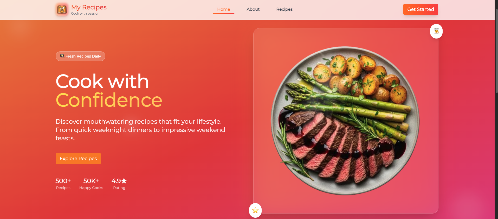
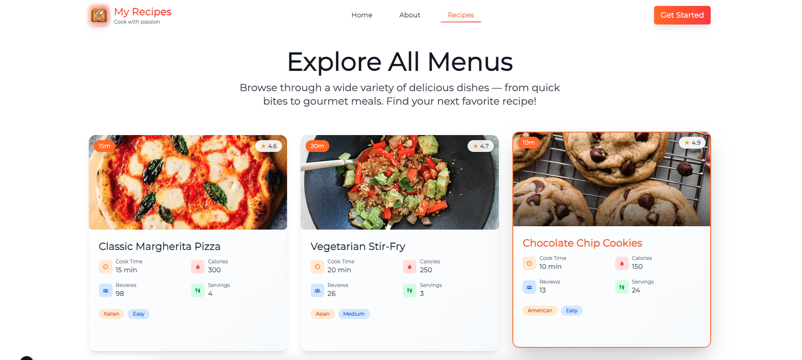
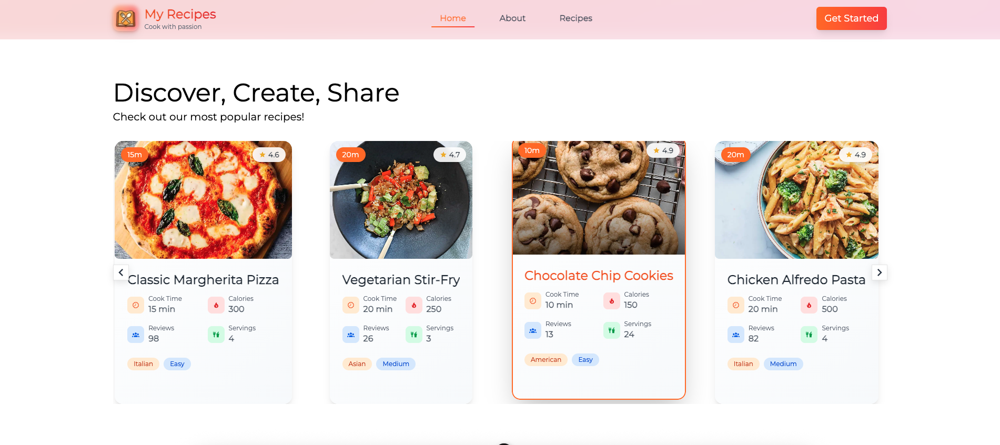
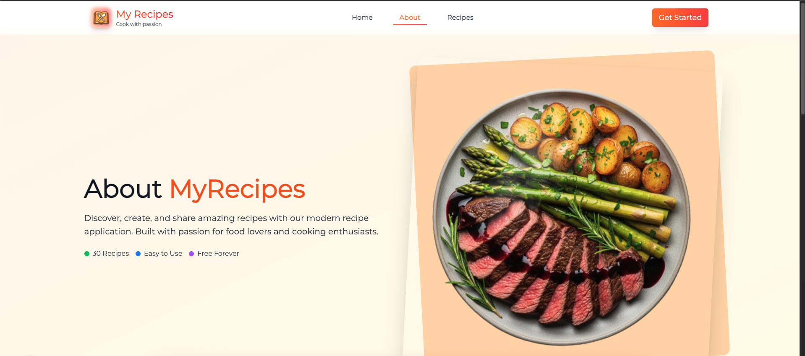
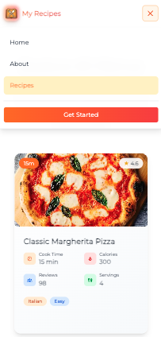

# MyRecipes 

A modern recipe discovery platform built with Nuxt 4, featuring beautiful UI design and responsive layout. Discover delicious recipes from around the world with an intuitive and engaging user experience.


## 📸 Screenshots

### Desktop Views

#### Homepage


_Modern hero section with gradient background, recipe carousel, and engaging call-to-action_

#### All Recipes


_Browse through a wide variety of delicious dishes with detailed recipe cards_

#### Recipe Carousel


_Interactive carousel showcasing featured recipes with smooth navigation_

#### About Page


_Learn more about MyRecipes with beautiful layout and engaging content_

### Mobile Views

#### Mobile Homepage


_Mobile View_

#### Mobile Navigation


_Mobile View_

## ✨ Features

- 🎨 **Modern UI Design** - Beautiful gradient backgrounds and smooth animations
- 📱 **Fully Responsive** - Works perfectly on desktop, tablet, and mobile
- 🍽️ **Recipe Discovery** - Browse and discover delicious recipes from around the world
- 🔍 **Interactive Carousel** - Smooth recipe carousel with navigation
- 🎯 **SEO Optimized** - Meta tags and structured data for better search visibility
- ⚡ **Fast Performance** - Built with Nuxt 3 for optimal performance
- 🎭 **Dark Footer** - Elegant footer with newsletter signup and social links

## 🚀 Tech Stack

- **Framework:** [Nuxt 3](https://nuxt.com/) - Vue.js framework
- **Styling:** [Tailwind CSS](https://tailwindcss.com/) - Utility-first CSS framework
- **Language:** [TypeScript](https://www.typescriptlang.org/) - Type safety
- **Icons:** [Nuxt Icon](https://github.com/nuxt-modules/icon) - Icon system
- **Carousel:** [Vue3 Carousel](https://github.com/ismail9k/vue3-carousel) - Smooth carousel component
- **Images:** [Nuxt Image](https://image.nuxt.com/) - Image optimization

## 📦 Installation

Make sure to install dependencies:

```bash
# npm
npm install

# pnpm
pnpm install

# yarn
yarn install

# bun
bun install
```

## 🛠️ Development

Start the development server on `http://localhost:3000`:

```bash
# npm
npm run dev

# pnpm
pnpm dev

# yarn
yarn dev

# bun
bun run dev
```

## 🏗️ Build

Build the application for production:

```bash
# npm
npm run build

# pnpm
pnpm build

# yarn
yarn build

# bun
bun run build
```

## 🎯 Preview

Locally preview production build:

```bash
# npm
npm run preview

# pnpm
pnpm preview

# yarn
yarn preview

# bun
bun run preview
```

## 📁 Project Structure

```
my_recipe/
├── app/
│   ├── components/          # Vue components
│   │   ├── Footer.vue      # Footer component
│   │   ├── MyButton.vue    # Reusable button component
│   │   ├── Navbar.vue      # Navigation component
│   │   ├── RecipeCard.vue  # Recipe card component
│   │   └── RecipeCarousel.vue # Recipe carousel
│   ├── layouts/            # Layout components
│   │   └── default.vue     # Default layout
│   ├── pages/              # Page components
│   │   ├── index.vue       # Homepage
│   │   ├── about.vue       # About page
│   │   └── recipes/        # Recipe pages
│   │       ├── index.vue   # All recipes
│   │       └── [id].vue    # Recipe detail
│   └── types/              # TypeScript types
│       └── types.ts        # Recipe and API types
├── public/                 # Static assets
│   └── screenshot/         # Screenshot
├── nuxt.config.ts          # Nuxt configuration
└── tailwind.config.js      # Tailwind CSS configuration
```

## 🎨 Key Components

### RecipeCard

- Modern card design with hover effects
- Recipe information display (cook time, calories, rating)
- Responsive grid layout
- Interactive hover animations

### Navbar

- Responsive navigation with mobile menu
- Sticky positioning with backdrop blur
- Social media integration
- Newsletter signup

### RecipeCarousel

- Smooth carousel navigation
- Responsive breakpoints
- Touch-friendly controls
- Optimized for different screen sizes

## 🌐 API Integration

The app integrates with external APIs to fetch recipe data:

- **DummyJSON API** - For recipe data and images
- **Dynamic routing** - For individual recipe pages
- **SEO optimization** - Meta tags and structured data

## 📱 Responsive Design

- **Mobile First** approach
- **Breakpoints:** 640px, 768px, 1024px, 1280px, 1536px
- **Touch-friendly** interactions
- **Optimized images** for all devices

---

Made with ❤️ and ☕ by Sultan Bransyah
